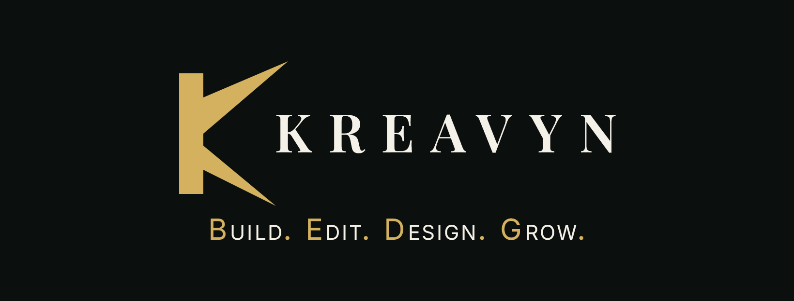

<!--
  KREAVYN profile README

  Setup:
  1. Repo name must be exactly: kreavynstudio  (public)
  2. Upload your banner image to this repo as: assets/banner.png
  3. Paste this file as README.md

  Icons come from the official Simple Icons CDN (cdn.simpleicons.org),
  recoloured to Champagne Gold #D4B15F. Change the hex at the end of any
  icon URL to recolour it.
-->

  

**Web Development &nbsp;·&nbsp; AI Video Editing**

*Build. Edit. Design. Grow.*

 

&nbsp;&nbsp;&nbsp;
&nbsp;&nbsp;&nbsp;
&nbsp;&nbsp;&nbsp;
&nbsp;&nbsp;&nbsp;
&nbsp;&nbsp;&nbsp;
&nbsp;&nbsp;&nbsp;

  

Based in Pakistan &nbsp;|&nbsp; Clients worldwide &nbsp;|&nbsp; Open for projects

 

---

## About

Kreavyn is a web development and AI video editing studio working with startups, businesses and creators worldwide.

We build fast, responsive websites and deliver clean, professional video edits. Clear communication, clean work, on-time delivery.

---

## Services

<table>
  <tr>
    <td width="50%" valign="top">
      <h3>Web Development</h3>
      Responsive business websites, landing pages and portfolios built with React, Next.js and Tailwind CSS. Shopify and WordPress sites.
    </td>
    <td width="50%" valign="top">
      <h3>AI Video Editing</h3>
      Clean, professional video edits for brands and creators.
    </td>
  </tr>
  <tr>
    <td colspan="2" align="center">
      <b>Coming soon:</b> Graphic Design &nbsp;·&nbsp; Digital Marketing
    </td>
  </tr>
</table>

---

## Tech Stack

<table>
  <tr>
    <td align="center" width="110"> HTML5</td>
    <td align="center" width="110"> JavaScript</td>
    <td align="center" width="110"> TypeScript</td>
    <td align="center" width="110"> React</td>
    <td align="center" width="110"> Next.js</td>
  </tr>
  <tr>
    <td align="center"> Tailwind CSS</td>
    <td align="center"> Bootstrap</td>
    <td align="center"> Node.js</td>
    <td align="center"> Shopify</td>
    <td align="center"> WordPress</td>
  </tr>
</table>

Also: CSS3 &nbsp;·&nbsp; JavaScript (ES6+) &nbsp;·&nbsp; SQL &nbsp;·&nbsp; Git &nbsp;·&nbsp; Responsive Design

---

## Selected Work

Built by our founder, Muhammad Farhan.

| Project | Type | Stack |
| :-- | :-- | :-- |
| [dotech.ae](https://dotech.ae) | Company website | React.js, Tailwind CSS |
| [khcuae.com](https://khcuae.com) | Business website | React.js, Tailwind CSS |
| [dhatsdefleurs.ae](https://dhatsdefleurs.ae) | Shopify store redesign | Shopify |
| [poliscents.com](https://poliscents.com) | Complete website, built from scratch | WordPress |
| [uxgazette.com](https://uxgazette.com) | Blog for a real client | WordPress |

---

## Work With Us

**kreavynstudio@gmail.com** &nbsp;|&nbsp; **WhatsApp +92 335-4051272**

Tell us what you need. We reply with a clear plan.

 

<!--
  Add these after the accounts exist. Do not guess links.
  LinkedIn:  [ADD LATER]
  Website:   [ADD LATER]
  Fiverr:    [ADD LATER]
  Upwork:    [ADD LATER]
-->

**Build. Edit. Design. Grow.**

